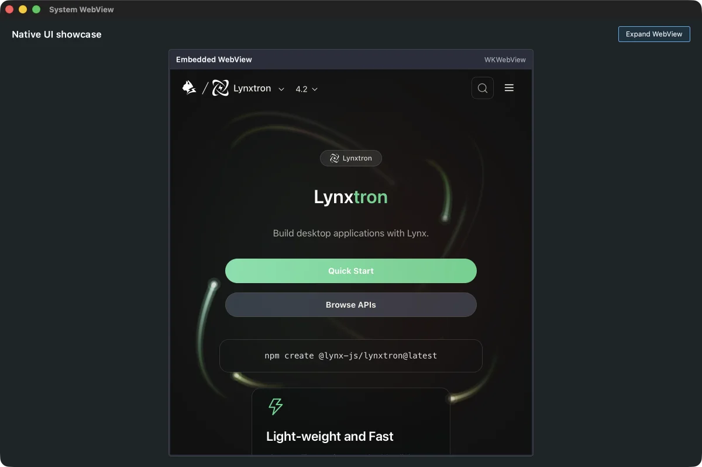

# Embed the system WebView

The same Lynx custom element hosts WKWebView on macOS and the installed
Evergreen WebView2 Runtime on Windows x64. Lynx renders the window controls and the frame around the embedded WebView. The WebView opens the
[Lynxtron homepage](https://lynxjs.org/lynxtron/index.html).



## Run from the repository root

Use Xcode Command Line Tools on macOS. On Windows use x64 Node.js, Visual Studio
2022 with Desktop development with C++ and a Windows SDK, CMake 3.20 or newer,
and the [Evergreen WebView2 Runtime](https://developer.microsoft.com/en-us/microsoft-edge/webview2/).
The first Windows build downloads the pinned WebView2 SDK from NuGet. Only
the loader is linked into the extension.

```sh
pnpm install
pnpm --filter @lynxtron-examples/config build
pnpm --filter @lynxtron-examples/system-webview run build:native-ui
pnpm --filter @lynxtron-examples/system-webview start
```

The WebView starts narrow. Use **Expand WebView** to widen the embedded page, then **Narrow WebView** to restore its initial width. Try **Quick Start** or **Browse APIs** inside the WebView, or resize the window. WebView2 keeps its
profile in `%LOCALAPPDATA%\LynxtronSystemWebViewExample`.

[The UI](src/app/index.tsx) passes the homepage URL to the custom element.
[The host](main.cjs) loads the compiled extension before opening a window.
The [macOS](system_webview.mm) and [Windows](system_webview_win.cc) implementations
register the same element and apply Lynx property, layout, and visibility updates.

The npm package contains the example source. To run it outside this workspace, unpack the npm tarball, run `npm install --include=dev` in its package directory, then `npm run build:native-ui` and `npm start`.
